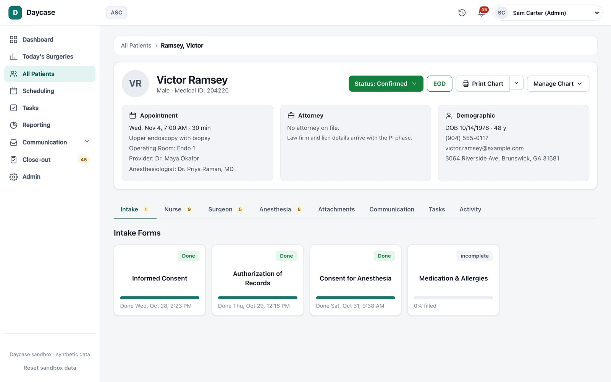

Daycase is charting software for same-day surgery, built for an outpatient surgical practice planning to move off its current system. It covers the whole day: scheduling, role-based patient charts, clinical forms, and case close-out.

<figure>
  
  <figcaption>A patient chart, with forms split by role. Synthetic patient.</figcaption>
</figure>

To make the switch easy for staff, it keeps the structure of the screens they already use: the same menus, chart tabs, form names, and statuses. The code and design are original. The practice's full form set is transcribed into it: 29 forms and about 500 questions, including scored assessments (Morse, Aldrete), patient-signed consents that freeze at the first signature, and an anesthesia time grid that charts blood pressure and pulse.

The server enforces the clinical rules, not the UI. Each tab can only be filled in by its own role. A clinician's signature line can only be signed by that clinician's team. A chart can't be closed until every required form is done and the visit has happened. Every change goes to the chart's activity log.

It's also built for AI agents to operate, not just people: a real REST API with stable error codes, stable labels on every control, an "act as" switch for staff roles, and a one-call reset to a known state.

**Stack:** TypeScript, React, Fastify, SQLite, Vitest, Playwright, AWS App Runner.

*Runs on synthetic patients only. Real patient data needs HIPAA-eligible hosting, authentication, and an access audit first.*
