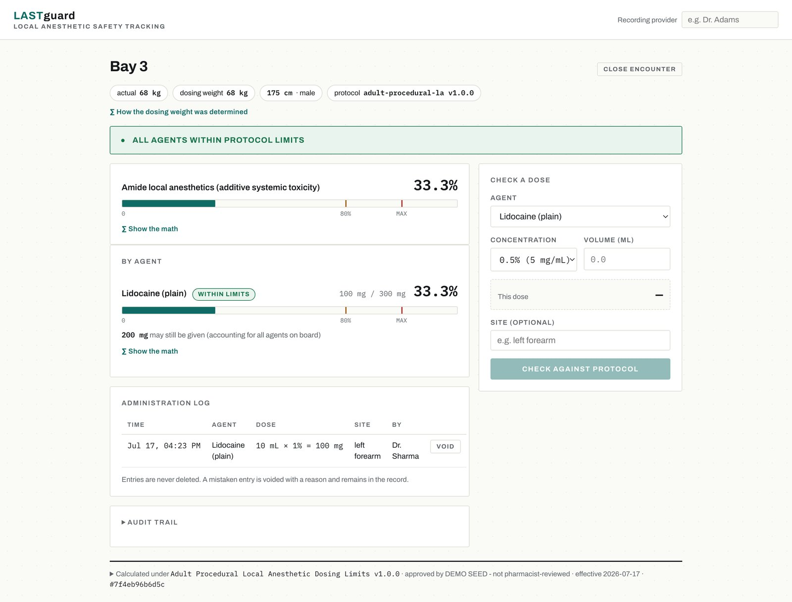

LASTguard is decision support for local anesthetic dosing. It answers "how much more can this patient safely receive?" - a question that goes unanswered when several providers dose the same patient and nobody sums the milligrams.

<figure>
  
  <figcaption>An encounter: cumulative exposure, what can still be given, and the pinned protocol version. Demo protocol.</figcaption>
</figure>

**This is a prototype. The protocols it ships with are demo content and have not been clinician-reviewed.** What it demonstrates is how safety software should be built:

- A pure, trace-emitting domain engine, so every answer can be audited back to its inputs.
- Content-hashed, immutable protocol versions pinned per encounter - a dose computed today is reproducible even after the protocol library changes.
- An append-only audit trail.
- Hand-computed golden-case tests.
- Scope deliberately held inside FDA non-device clinical-decision-support boundaries.

**Stack:** FastAPI, SQLAlchemy, Pydantic, React + TypeScript, golden-case test suite.

*Not yet public; a repo pass is planned.*
